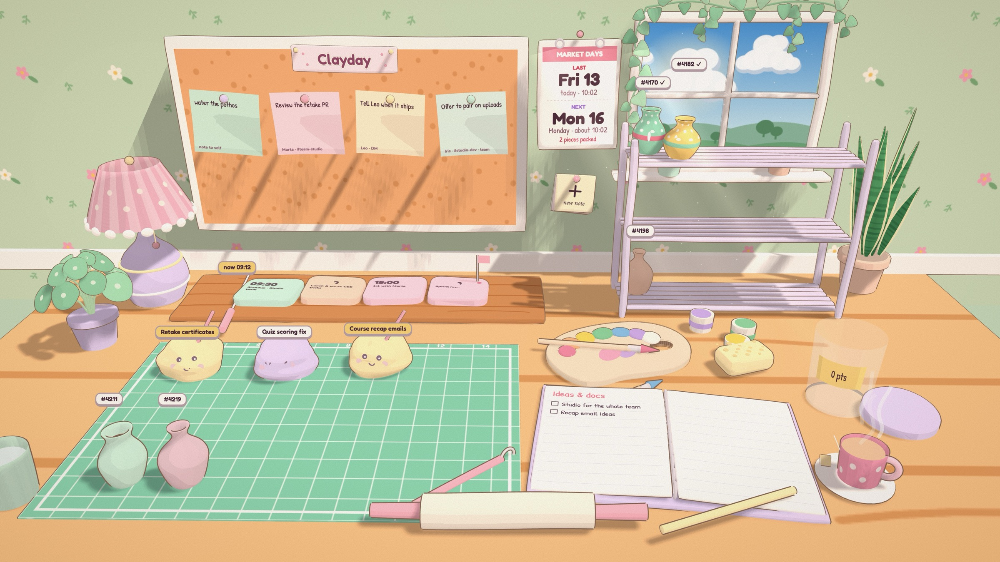
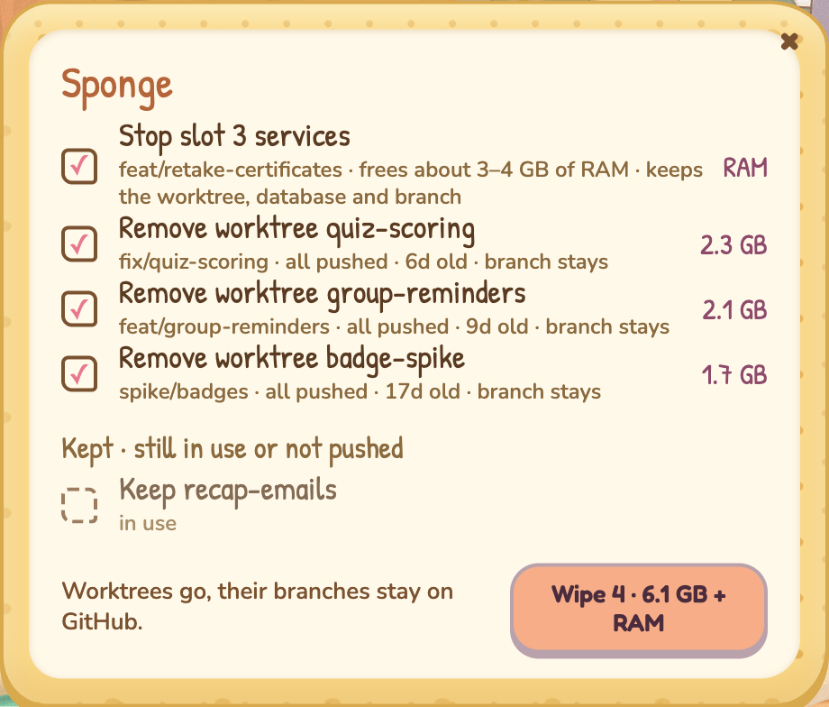
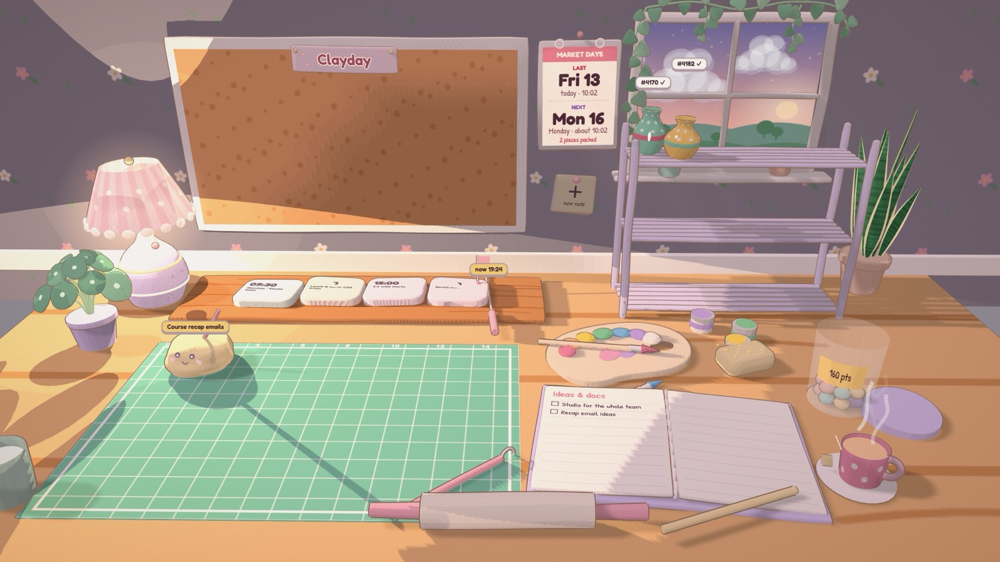

# Clayday

**Your workday as a cosy air-dry clay studio.** Open it in the morning, sit down at the table and see where you stopped yesterday: Slack asks, meetings, Claude sessions, pull requests and ideas, all modelled by hand.



Clayday is a [Claude artifact](https://claude.ai/artifact/TNg5ybJTyXpN9SnCiJSdwF) (a three.js scene in one HTML page) plus a small local helper that reads your Claude sessions, cmux tabs and GitHub. The light follows the real clock, from dawn to dusk.

## What is on the table

| Object | What it shows | What you can do |
| --- | --- | --- |
| **Corkboard** | Slack messages that need you: mentions, DMs and pings to your team group, as sticky notes. Your own notes go here too. | **Done** adds ✅ to the Slack message. **👀 On it** adds 👀 and keeps the note. **Discard** removes it for good. |
| **Sticky-note pad** | A pad beside the board. | Click it to pin a note to yourself. |
| **Work board** | Today's meetings as clay slabs, with a "now" flag. | Click a slab to join the call. |
| **Cutting mat** | Your Claude sessions as sleepy clay lumps, and your open PRs as unfinished vases. | **Open in cmux** jumps to the tab. **Done** closes the cmux tab. |
| **Drying rack** | Merged PRs that wait for the next production deploy, painted. Review requests for your team. | Click a piece to open it on GitHub. |
| **Market calendar** | The last production deploy and the next one ("market day"). | Links to your deploy dashboard, if you set one. |
| **Sketchbook** | Ideas you want to make, and the Claude artifacts you published from this computer. | Turn an idea into a Notion page or a Claude doc. Find and open an artifact. |
| **Sponge** | Things on your Mac that you no longer need. | Squeeze it to free RAM and disk (see below). |
| **Jar** | A clay pellet for each thing you finish today. | Click it to see the list and undo. |
| **Rolling pin** | | Roll it to refresh everything. |
| **Tea** | | Take a sip. |


A cheeky **studio spirit** writes the plan card at the top left. It reads what is still open and suggests up to three next moves. Items you mark Done never come back on a later day, and a Slack thread comes back only when someone writes in it again.

## The sponge



The sponge finds things that are safe to clean up:

- Services of dev-pool slots that no session uses (if you set up a pool). It stops them (about 3–4 GB of RAM for each slot) and keeps the worktree, database and branch.
- Worktrees whose work is all pushed and clean. It removes them with `git worktree remove`. The branches stay on GitHub.
- `node_modules` in worktrees that you did not touch for 7 days (not ticked by default).
- Records of worktrees whose folder is already gone.

It never touches the main checkout, the pool slots themselves, unpushed or uncommitted work, or a folder that is open in cmux, used by a running process or used by a recent Claude session. It checks each item again just before it cleans.

## How it works

```
studio.html   the artifact: scene, UI and data loading
server.mjs    stdio MCP server; it only loads tools.mjs again when that file changes
tools.mjs     the helper's tools: studio_config, my_artifacts, claude_sessions, github_prs, open_session,
              close_session, sponge_scan, sponge_wipe
video/        the showcase video (HyperFrames) and its capture rig
```

The page gets its data through artifact capabilities:

- **Google Calendar** for meetings, **Slack** for asks and reactions, **Notion** and **Claude Docs** for the sketchbook.
- **`host:clay-studio`** for your settings (`studio_config`) and local data: Claude sessions (desktop app records and CLI transcripts), cmux tabs (`~/Library/Application Support/cmux`), GitHub through `gh`, and the sponge.
- **`db`** to keep your progress, sticky notes and sketchbook. **`sample`** to sort Slack and write the plan card.

## Set it up

1. Register the helper with Claude Code. Use the absolute path to your `node`, because the desktop app does not see your shell's `PATH`:

   ```bash
   claude mcp add -s user clay-studio -- "$(which node)" "$PWD/server.mjs"
   ```

2. Add the same server to the Claude desktop app's `claude_desktop_config.json` under `mcpServers`.
3. Quit the Claude app with ⌘Q and open it again.
4. Open the [artifact](https://claude.ai/artifact/TNg5ybJTyXpN9SnCiJSdwF) in the Claude app and allow the connectors when it asks.

Edits to `tools.mjs` apply at once. You do not need to restart the app.

## Your settings

Personal and work settings never go in this repo. The helper reads them from `~/.config/clayday/config.json` (or the file in `CLAYDAY_CONFIG`). Copy [`config.example.json`](config.example.json) there and fill it in:

| Key | What it is for |
| --- | --- |
| `name`, `about` | The greeting, and a line about you for the studio spirit. |
| `slack.userId`, `slack.teamId`, `slack.teamHandle` | Your Slack mentions and your team group's pings. |
| `deployDashboardUrl` | The link on the market calendar. |
| `github.repo`, `github.reviewTeam`, `github.reviewBase` | Your PRs, deploy tags (`production-*`) and your team's review queue. Only PRs that target `reviewBase` (default `main`) show, so stacked PRs stay out. |
| `sponge.repos`, `sponge.pool` | Which repos the sponge checks for worktrees, and an optional pool of dev slots with `pool-status.sh` and `slot-stop.sh` scripts. |

`CLAY_GH` sets the path to `gh` if it is not in `/opt/homebrew/bin` or `/usr/local/bin`.

## The video

[`video/`](video) holds a 46-second showcase, "A morning at the table": one camera move across the studio from dawn to dusk.



- `video/capture/capture.mjs` renders the real page with sample data (not real Slack or PRs) to 4K stills.
- `video/film/build.py` writes the HyperFrames scene: camera moves, cursor, captions and the real UI panels.
- `video/capture/music.py` makes the music bed with MusicGen on your Mac.

```bash
cd video/film
python3 build.py
npx hyperframes render -q delivery -o renders/clayday.mp4
```
